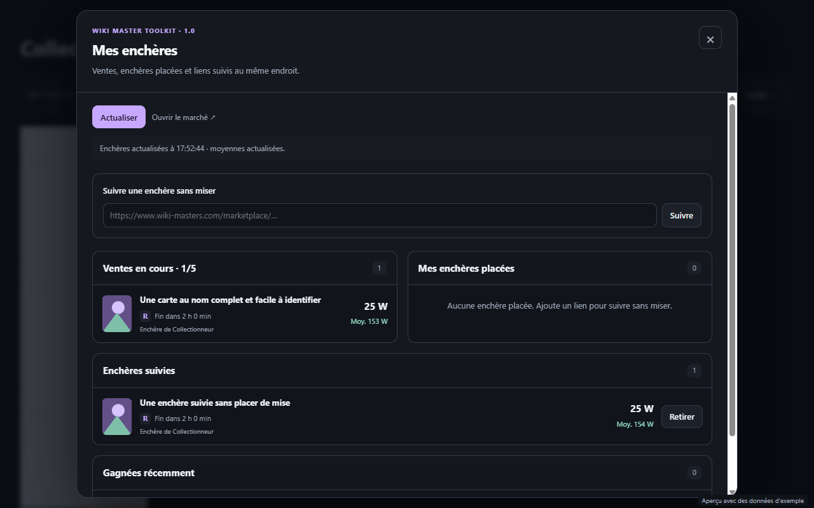
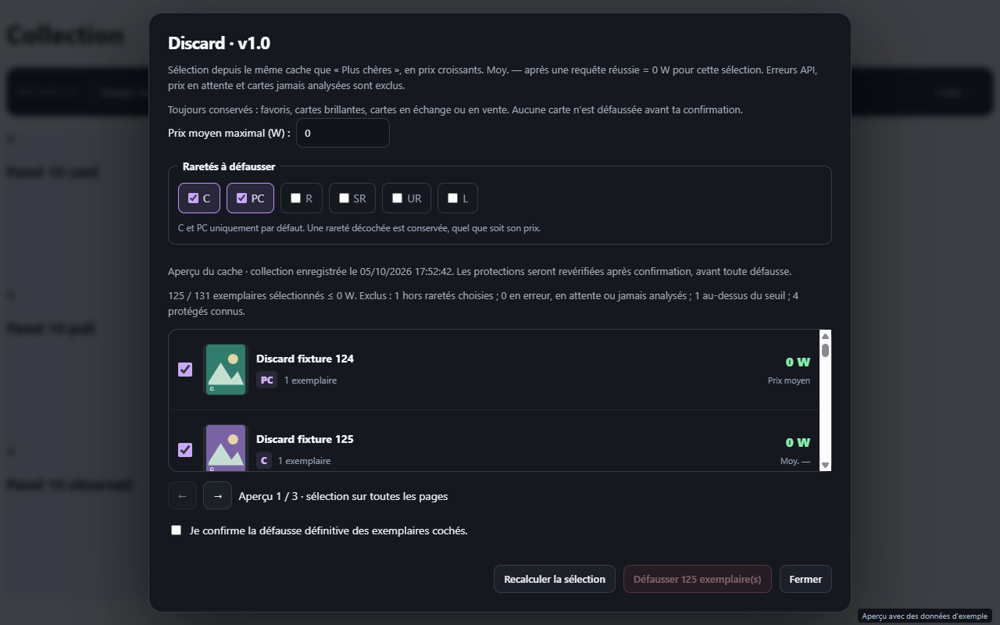

# Wiki Master Toolkit

**Les prix, la collection, les paquets et le marché WikiMasters dans une seule interface.**


Fork indépendant de [WikiMastersTools-kzfamily](https://github.com/qkerman/WikiMastersTools-kzfamily), créé par **qkerman / la kzfamily**. Le Toolkit reprend leurs outils et ajoute une interface unifiée, un cache permanent des prix, la synchronisation locale et les adaptations pour Atlas. Il n’est pas affilié à WikiMasters.

[Installer](#installation) · [Premiers pas](#premiers-pas) · [Synchroniser](#synchronisation-entre-ordinateurs) · [Confidentialité](PRIVACY.md) · [Signaler un problème](https://github.com/Clascheurduturfu/wiki-master-toolkit/issues)

## Les outils

| Outil | Utilité |
| --- | --- |
| **Prix moyens** | Moyenne correspondant à la rareté de chaque carte. Chargement automatique des prix manquants, réponses réussies conservées sans expiration. |
| **Collection** | Vue des cartes les plus chères et chargement des prix par rareté, au-delà des 50 cartes d’une page. |
| **Défausse** | Sélection par prix maximal, filtre C / PC et aperçu illustré. Favoris, brillantes, cartes en vente et en échange protégés. Confirmation avant toute défausse. |
| **Paquets** | Ouverture groupée, ouverture automatique facultative, récapitulatif et statistiques par rareté. Pause pour résoudre les vérifications humaines. |
| **Mes enchères** | Ventes, enchères et gains récents, avec images et moyennes actualisées. Suivi par lien sans avoir misé. |
| **Succès** | Recherche des nouveaux succès et bouton pour réclamer les récompenses disponibles. |
| **Sauvegardes et synchronisation** | Export / import et partage des prix et statistiques via un dossier local choisi. |

### Aperçu

Ces captures présentent **des données d’exemple**.





## Installation

Pour **Chrome sur Windows ou macOS** :

1. Télécharger le [ZIP Toolkit](https://github.com/Clascheurduturfu/wiki-master-toolkit/archive/refs/heads/toolkit.zip) et le décompresser, ou cloner le dépôt :

   ```sh
   git clone --branch toolkit https://github.com/Clascheurduturfu/wiki-master-toolkit.git
   ```

2. Ouvrir `chrome://extensions/` et activer **Mode développeur**.
3. Cliquer sur **Charger l’extension non empaquetée** et sélectionner le dossier contenant `manifest.json`.
4. Rafraîchir [WikiMasters](https://www.wiki-masters.com/collection) dans votre session connectée.

Pour éviter les boutons et requêtes en double, désactiver les autres extensions WikiMasters qui remplissent les mêmes fonctions. La compatibilité Firefox de ce fork n’a pas été validée ; les instructions du projet d’origine concernent sa propre version.

### Mise à jour

Dans le dossier cloné :

```sh
git pull --ff-only
```

Puis **Recharger** l’extension dans `chrome://extensions/` et rafraîchir WikiMasters. Avec un ZIP, remplacer les fichiers du dossier déjà chargé, puis recharger.

**Ne pas effacer les données du site pour mettre à jour** : elles contiennent les prix et statistiques existants. Une extension non empaquetée ne reçoit pas les mises à jour du Chrome Web Store.

## Premiers pas

1. Dans la collection, ouvrir **Charger les prix**, sélectionner les raretés souhaitées et lancer le chargement. **Toutes** initialise les moyennes de votre collection.
2. Les prix enregistrés sont ensuite réutilisés. Les nouvelles cartes obtenues dans les paquets alimentent le même cache.
3. Utiliser **Plus chères**, **Discard**, **Mes enchères** ou **Succès** depuis la barre d’outils. Les fonctions secondaires sont dans **Outils**.

Les prix sont des **moyennes de ventes passées**, pas des estimations garanties ni un suivi du marché en temps réel. Ils restent enregistrés jusqu’à une actualisation manuelle, une nouvelle réponse du site ou la suppression des données.

Un **Moy. —** issu d’une réponse réussie signifie qu’aucune moyenne n’est disponible pour cette rareté ; il compte comme zéro uniquement pour le filtre de défausse. Une erreur API, un prix en attente ou une carte jamais analysée ne comptent jamais comme zéro. L’aperçu précède votre confirmation. [Détails de la défausse](DISCARD.md).

## Synchronisation entre ordinateurs

La synchronisation est **facultative**. Le Toolkit utilise un dossier que vous autorisez ; Google Drive pour ordinateur ou un autre logiciel peut transporter ce dossier entre vos machines.

1. Sur l’ordinateur qui possède vos données, ouvrir **Outils → Synchronisation → Choisir un dossier**.
2. Choisir un dossier dédié à ce compte WikiMasters et autoriser son accès. Les données existantes sont exportées automatiquement.
3. Sur l’autre ordinateur, installer le Toolkit, ouvrir le même compte et choisir le dossier synchronisé correspondant.

Utiliser **un dossier par compte**. Chaque session écrit son propre fichier ; les prix les plus récents sont conservés et les statistiques sont fusionnées sans doubler les tirages. Cookies, jetons de connexion et identifiants VPN ne sont pas inclus.

Le navigateur peut demander de réautoriser le dossier. Les transferts dépendent aussi du logiciel de synchronisation ; une page fermée ne synchronise pas. [Fonctionnement détaillé](ATLAS-FORK.md#local-folder-sync-on-windows-and-mac).

## Atlas

Le Toolkit fonctionne dans Chrome sans Atlas. Dans **Atlas Browser**, son intégration partage les prix réussis entre les panneaux via une base locale, tout en conservant des sessions de compte distinctes. Les fonctions VPN et de synchronisation VPS appartiennent à l’application Atlas et ne sont pas fournies par cette extension autonome.

[Intégration Atlas](ATLAS-FORK.md) · [Prix partagés et vérification des paquets](SHARED-PRICES.md) · [Enchères et succès](ACTIVITY.md)

## Confidentialité et permissions

Les outils utilisent la session déjà ouverte sur WikiMasters. Les données restent dans le navigateur ou dans le dossier autorisé ; l’extension autonome ne contacte aucun serveur de synchronisation du fork.

Les requêtes nécessaires vont à WikiMasters et à ses services, ainsi qu’aux sources publiques d’illustrations et de familles. `clipboardWrite` permet de copier une image après un clic. Le Toolkit ne lit pas le presse-papiers et n’ajoute pas de télémétrie publicitaire. Les vérifications humaines et limites du site restent applicables.

Consulter la [politique complète](PRIVACY.md) pour les services contactés, les sauvegardes et la suppression des données.

## Contribuer et obtenir de l’aide

Ouvrir une [issue](https://github.com/Clascheurduturfu/wiki-master-toolkit/issues) avec la version affichée, le navigateur, les étapes et le résultat attendu. Retirer cookies, jetons et identifiants des captures et journaux partagés.

Aucune compilation n’est nécessaire. Avec **Node.js 22 ou plus récent**, les tests existants se lancent depuis la racine :

```sh
node --test tests/*.test.cjs tests/*.test.js
```

Les propositions se font sur une branche dédiée et par pull request. **`toolkit`** contient cette version ; **`main`** conserve l’historique d’origine. Les notes techniques peuvent utiliser les anciens numéros internes Atlas, distincts de la version publique **1.0**.

## Origine et autorisation

Merci à **qkerman / la kzfamily** pour le projet d’origine. Son auteur a autorisé le fork et la publication dans [l’issue nº 43](https://github.com/qkerman/WikiMastersTools-kzfamily/issues/43), et [encourage désormais les forks](https://github.com/qkerman/WikiMastersTools-kzfamily/commit/4d90ac22a17d3ceb8d5dd1543e4a8de7d2e834d6).

Cette autorisation ne constitue pas une licence générale MIT ou GPL. Voir [ATTRIBUTION.md](ATTRIBUTION.md). La [documentation d’origine](docs/UPSTREAM-README.fr.md) est conservée séparément ; elle décrit le projet amont, pas nécessairement ce fork.
